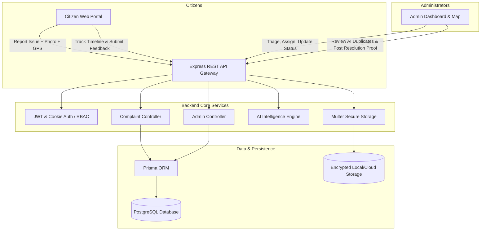
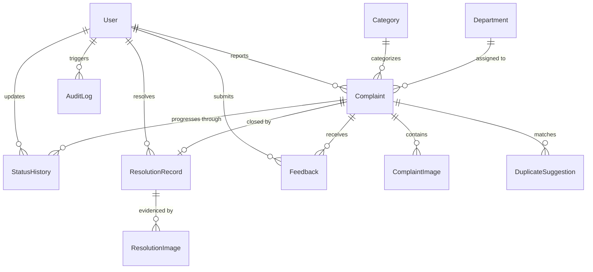

# CivicConnect - System Architecture & Engineering Specifications

**Hackathon Problem Statement:** PS-14  
**Project:** Community Problem Reporting and Resolution Platform  
**Tagline:** Your City. Your Voice. Our Responsibility.

---

## 1. System Overview

CivicConnect is a modern civic-technology web platform designed to bridge citizens and municipal administrators. It enables citizens to report local civic issues (roads, electricity, waste, water, public infrastructure), upload geo-tagged photographic evidence, track status progression transparently, and submit satisfaction feedback upon verified administrative resolution.

Administrators are equipped with high-throughput workflow tools: real-time dashboard analytics, interactive Leaflet OpenStreetMap geographic clusters, automated and AI-assisted duplicate report detection, priority and department triage, granular audit logging, and cryptographic accountability for problem resolution.

---

## 2. PS-14 Core Functional Requirements & Verification

| Requirement | Implementation Component | Verification Criteria |
|---|---|---|
| **1. Multi-modal submission** | `POST /api/complaints` + Multer | Accepts text title/description, category, coordinates, up to 5 photos |
| **2. Categorization & Prioritization** | Category & Priority Enums | Roads, Streetlights, Waste, Water, Public Facilities, Other; Low/Med/High/Urgent |
| **3. Lifecycle status tracking** | `status_history` relational ledger | Immutable state transitions: SUBMITTED -> UNDER_REVIEW -> IN_PROGRESS -> RESOLVED |
| **4. Interactive GIS Map** | Leaflet + OpenStreetMap | Spatial distribution, category icons, cluster views, admin filtering |
| **5. Duplicate Detection Engine** | Heuristic + AI vector similarity | Spatial proximity + Levenshtein text match + AI semantic comparison |
| **6. Privacy & Sensitive Protection** | Geo-masking & Upload guards | Coordinates optional; image mime/buffer validation; citizen isolation |
| **7. Role-Based Access Control** | Auth Middleware + HTTP-only JWT | Strict backend policy: Citizens can only access own records; Admin routes guarded |
| **8. Unreviewed Integrity** | Workflow engine constraint | New complaints default to SUBMITTED; never published as verified until review |
| **9. Resolution Accountability** | `resolution_records` table | Resolution strictly requires administrator identity, description, and proof photo |

---

## 3. Database Entity Relationship Model

